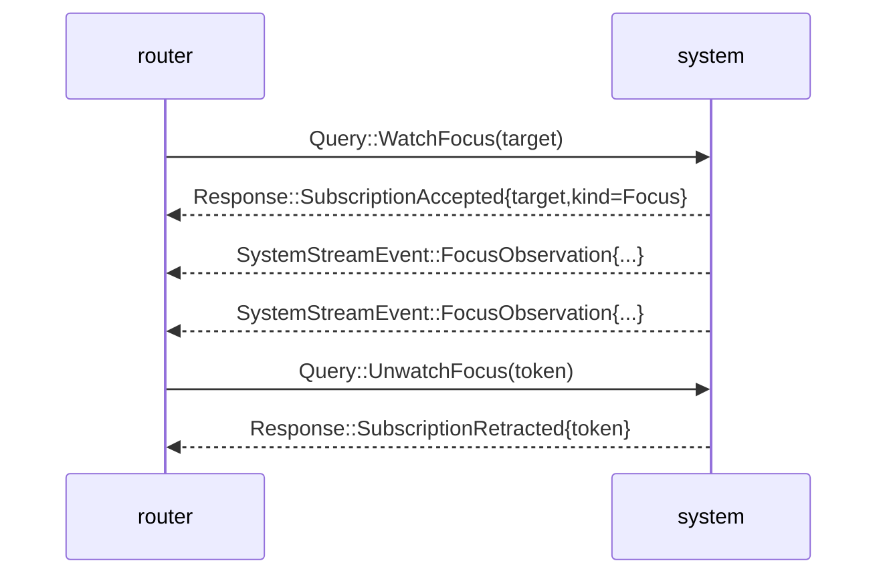

# signal-system — architecture

*The Signal contract between `system` (producer of OS facts) and `router`
(consumer of focus observations).*

## 0 · TL;DR

`signal-system` carries one bidirectional channel between the router
(request side, opens subscriptions) and the system observer (response /
event side, emits focus observations). The router subscribes once per
target and the system pushes events; the router never polls.

## 1 · The contract source

`ethos/signal.ethos` is the authority. `ethos-zero` generates
`src/generated/signal.rs` from it, the generation is committed, and
`build.rs` asserts the committed file equals a fresh generation. No
`Datomic` implementation for a declared type is hand-written.

The wire is rkyv: `Signalizable::signalize` archives a contract value into
a `Signal<T>` frame and `Restorable::restore` reads one back. The `datom`
feature additionally gives every declared type its Datom text form through
`datom-codec`.

## 2 · Channel

| Side | Component |
|---|---|
| Request side | `router` |
| Response / event side | `system` |

The router initiates subscriptions via `Query`; the system answers direct
requests with `Response` and pushes `SystemStreamEvent` frames as focus
state changes. The steady-state flow is system → router.

## 3 · Messages

```text
Query                                    Response
├─ WatchFocus(FocusSubscription)         ├─ SubscriptionAccepted
├─ UnwatchFocus(FocusSubscriptionToken)  ├─ SubscriptionRetracted(token)
├─ QueryFocus(FocusSnapshot)             ├─ ObservationTargetMissing
└─ QueryStatus(SystemStatusQuery)        ├─ SystemStatus
                                         ├─ SystemRequestUnimplemented
                                         └─ FocusObservation

SystemStreamEvent
├─ FocusObservation
└─ WindowClosed
```

The full lifecycle:



The closing exchange — request retract plus response ack — is the Path A
discipline. The ack is the final frame consumers bind their in-flight
subscribe to. `FocusSubscriptionToken` is the per-stream identity, the same
shape as `FocusSubscription` but a distinct type so subscribe and close
sites do not conflate "open this stream" with "name the stream to close."

`QueryFocus` is the one-shot form: it is answered by a single
`Response::FocusObservation` and opens no stream.

## 4 · Wire vocabulary

Records local to this contract: `SystemTarget`, `NiriWindowId`,
`ObservationGeneration`, `Focused`, `FocusSubscription`,
`FocusSubscriptionToken`, `FocusSnapshot`, `SystemStatusQuery`,
`FocusObservation`, `WindowClosed`, `SubscriptionAccepted`,
`SubscriptionKind`, `ObservationTargetMissing`, `SystemStatus`,
`SystemHealth`, `SystemReadiness`, `SubscriptionRetracted`,
`SystemRequestUnimplemented`, `SystemUnimplementedReason`,
`SystemOperationKind`, `SystemStreamEvent`.

`SystemBackend` is **imported** from `meta-signal-system`. The privileged
plane owns backend selection and the daemon's typed startup record
(`SystemDaemonConfiguration`); declaring a second `SystemBackend` here
would fork the wire. This contract names the backend in
`SystemStatusQuery` and `SystemStatus` by importing the one that exists.

If a future channel needs `SystemTarget`, make or update the
relation-specific `signal-*` contract for that relation. Do not lift
system-observation payloads into another component's contract; this crate
owns the system observation vocabulary.

## 5 · Closed-enum integrity

```text
SystemHealth              SystemReadiness        SubscriptionKind
  | Running                 | Ready               | Focus
  | Degraded                | Starting
  | Stopped                 | Unavailable

SystemUnimplementedReason     SystemOperationKind
  | NotBuiltYet                 | WatchFocus
  | BackendUnavailable          | UnwatchFocus
                                | QueryFocus
                                | QueryStatus
```

`SystemTarget` is a closed enum (`NiriWindow(NiriWindowId)`); future
backends add variants through a coordinated schema upgrade. The contract
has no `Unknown` variant on any wire enum.

## 6 · Constraints

| Constraint | Witness |
|---|---|
| The committed generated Rust matches the ethos source. | `build.rs` asserts it on every build. |
| Every contract head round-trips through received rkyv bytes. | `tests/contract.rs::queries_round_trip_through_received_bytes`, `responses_round_trip_through_received_bytes`, `stream_events_round_trip_through_received_bytes`. |
| A malformed frame is rejected rather than misread. | `tests/contract.rs::malformed_archive_is_rejected`. |
| Every canonical Datom line is a real contract head. | `tests/contract.rs::every_canonical_datom_line_actualizes_into_a_contract_head` actualizes each line of `examples/canonical.datom` into `Query`, `Response`, or `SystemStreamEvent`. |
| Datom text round-trips back to the same value. | `tests/contract.rs::queries_round_trip_as_datom_text`. |
| Behavior is homed in traits, not free functions or inherent methods. | `checks/no-free-functions.sh` and `checks/no-inherent-methods.sh` in `nix flake check`. |
| Request payloads do not mint observation generations; `system` mints those. | `ObservationGeneration` appears only in `FocusObservation`, a response/event record. |
| Git dependencies resolve to immutable producer identities. | Every Git dependency in `Cargo.toml` declares an exact `rev`; no dependency follows a moving branch. |
| Runtime code stays out of the contract. | Source scan: no Kameo, Tokio, socket, or redb code. |

## 7 · Versioning

The 2.x line is the Datom stack. Schema-level changes — a new subscription
kind, a new observation event, a new `SystemBackend` value — are breaking;
coordinate `system` and `router` on the upgrade.

## 8 · Non-ownership

- No Niri adapter — that is `system`.
- No focus-tracker actor — that is `system`.
- No terminal prompt-gate logic — that is `terminal` / `terminal-cell`.
- No transport (UDS path, reconnect, timeouts).
- No subscription accounting — that is `system`'s actor.
- No daemon configuration — that is `meta-signal-system`.

## 9 · Code map

```text
ethos/signal.ethos        — the contract source, the wire authority
build.rs                  — asserts the committed generation is fresh
src/generated/signal.rs   — generated by ethos-zero, committed
src/lib.rs                — the rkyv Signal frame surface
examples/canonical.datom  — one canonical Datom line per contract head
tests/contract.rs         — rkyv round trips, Datom round trips, canonical gate
```

## See also

- `meta-signal-system/ARCHITECTURE.md` — the privileged configuration plane.
- `signal-harness/ARCHITECTURE.md` — sibling contract on the same stack.
- `signal-message/ARCHITECTURE.md` — companion channel the router consumes
  alongside this one.
